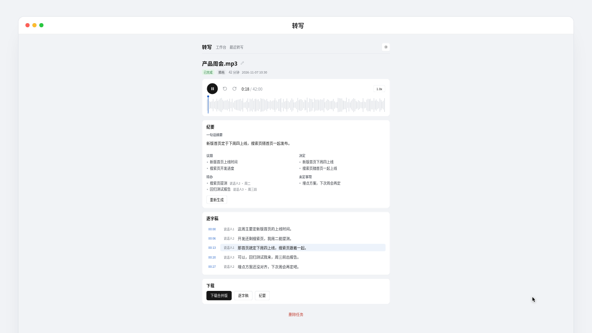
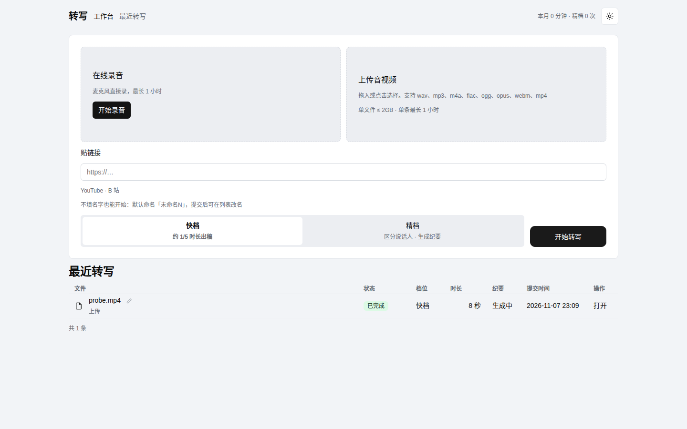
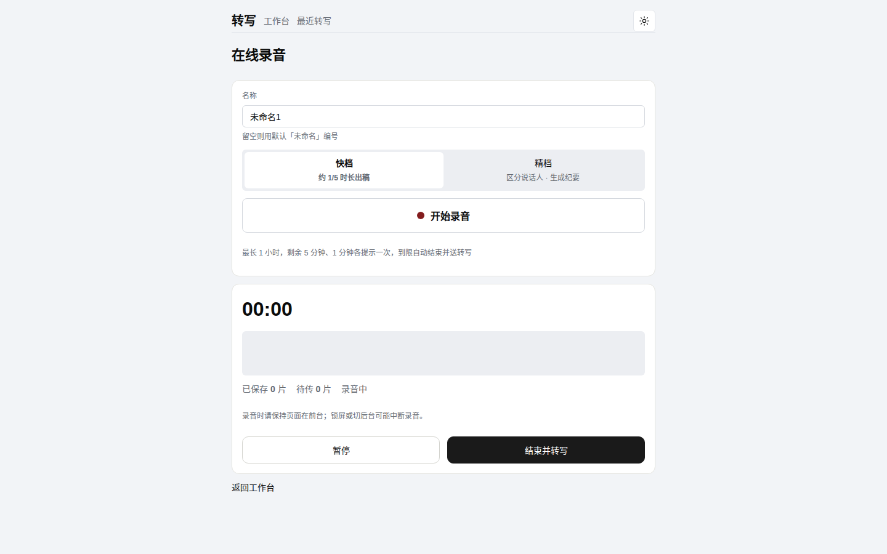

<div align="center">

# 转写 · Transcriber

**自托管的音频转写与会议纪要工具**

上传一段录音、贴一个链接，或者直接在浏览器里录 — 回来就是带说话人区分的逐字稿和一份结构化纪要。


<a href="docs/media/intro.mp4"></a>

▶ [观看 20 秒产品介绍视频](docs/media/intro.mp4)

</div>

## 功能

- **三种提交方式**：上传音视频文件（wav / mp3 / m4a / flac / ogg / opus / webm / mp4，单文件 ≤ 2GB）；贴链接导入（YouTube、B 站等，yt-dlp 驱动）；浏览器**在线录音**（最长 1 小时，实时波形，分片自动保存，结束即转写）
- **双档转写**：快档约 1/5 时长出稿；精档区分说话人并生成纪要，按需二选一
- **逐字稿**：按说话人分段、带时间戳；详情页内置播放器（全幅波形、倍速、点段定位播放）
- **会议纪要**：固定五节结构 — 一句话摘要 / 议题 / 决定 / 待办（带负责人）/ 未定事项，可一键重新生成
- **Markdown 导出**：合并版 / 逐字稿 / 纪要三种下载
- **任务管理**：改名、删除、本月用量统计；浅色 / 深色双主题
- **纯本机运行**：转写在本机 CPU 上跑（FunASR / faster-whisper），数据不出机器；纪要走可插拔的 LLM 通道

## 界面

| 工作台 | 在线录音 |
| --- | --- |
|  |  |

详情页播放器与波形：


## 两档转写

| 档位 | 引擎 | 模型 | 特点 |
| --- | --- | --- | --- |
| 快档 `fast` | FunASR | SenseVoiceSmall + fsmn-vad + cam++ | 约 1/5 时长出稿，自带说话人分段 |
| 精档 `precise` | faster-whisper | medium（int8） | 区分说话人、生成纪要，繁转简（OpenCC） |

引擎与模型只定义在 `app/config.py` 的 `TIER_CONFIG` 一张表里，换模型改表即可。

## 快速开始

需要本机已有 `ffmpeg`、`ffprobe` 和 [uv](https://docs.astral.sh/uv/)。Python 用仓库内的 3.12 虚拟环境，不要往系统 Python 装包。

```bash
uv sync
./run.sh        # 默认只听 127.0.0.1:8900
```

浏览器打开 `http://127.0.0.1:8900/` 即可使用；JSON API 走 `/jobs`。

Docker 部署：

```bash
docker compose up -d --build
```

提交一条本地音频试一下：

```bash
curl -s -F "file=@tests/fixtures/s2_60.wav" -F "tier=fast" http://127.0.0.1:8900/jobs
```

## 配置

| 环境变量 | 说明 |
| --- | --- |
| `TRANSCRIBER_HOST` / `TRANSCRIBER_PORT` | 监听地址与端口，默认 `127.0.0.1:8900` |
| `TRANSCRIBER_DATA_DIR` | 任务库和产物目录，默认 `./data` |
| `TRANSCRIBER_LLM_PROVIDER` | 纪要通道：`nous`（默认）/ `ollama` / `spark` / `custom` |
| `TRANSCRIBER_LLM_API_KEY` | 纪要接口密钥，也可写在 `~/.transcriber/transcriber.env` |
| `TRANSCRIBER_LLM_MODEL` / `TRANSCRIBER_LLM_BASE_URL` | 覆盖通道默认模型与地址，对**所有通道**生效 |

### 纪要通道

通道表在 `app/config.py` 的 `LLM_PROVIDERS`，四条通道都走 OpenAI 兼容接口：

| 通道 | 默认模型 | 默认地址 | 需要密钥 |
| --- | --- | --- | --- |
| `nous`（默认） | `stepfun/step-3.7-flash:free` | `https://inference-api.nousresearch.com/v1` | 是 |
| `ollama` | `qwen2.5:7b` | `http://127.0.0.1:11434/v1` | 否 |
| `spark` | `spark-x2.6` | `https://maas-api.cn-huabei-1.xf-yun.com/v2` | 是 |
| `custom` | 无默认（必填） | 无默认（必填） | 否 |

`custom` 用来接任意 OpenAI 兼容端点（讯飞、智谱、OpenRouter、本地网关等），没有默认地址与模型，必须自己填；不填会在纪要那一步报错（只影响纪要，已完成的转写不受影响），改好配置重启后重新生成纪要即可。

```bash
# ~/.transcriber/transcriber.env 示例
TRANSCRIBER_LLM_PROVIDER=custom
TRANSCRIBER_LLM_BASE_URL=https://api.example.com/v1
TRANSCRIBER_LLM_MODEL=magpie-chat
TRANSCRIBER_LLM_API_KEY=sk-xxx   # 端点需要密钥时才填
```

切回 ollama 时注意：`MODEL` / `BASE_URL` 是对所有通道生效的全局覆盖，只改 provider 不够，要把这两项也改回 ollama 的地址与模型（或清空回落默认）再重启。Docker 部署下 ollama 是另一个容器，`BASE_URL` 须显式写成 `http://ollama:11434/v1` 并只写进 env_file，宿主 shell 的 export 不会进容器。

## 开发

```bash
uv run mypy app        # 类型检查
uv run ruff check .    # 代码风格
uv run pytest          # 测试套件
uv run python scripts/smoke.py tests/fixtures/s2_60.wav   # 服务在跑时做一次 fast 冒烟
```

## ⚠️ 安全须知

**本工具没有账号鉴权**，设计前提就是跑在内网或 Tailscale 里自用：请只绑定 `127.0.0.1` 或你的 tailnet 地址，**禁止公网暴露**，不要加内网穿透。链接导入带 SSRF 防护（拒绝内网地址），但这不构成把它放到公网的理由。
